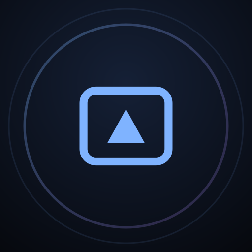
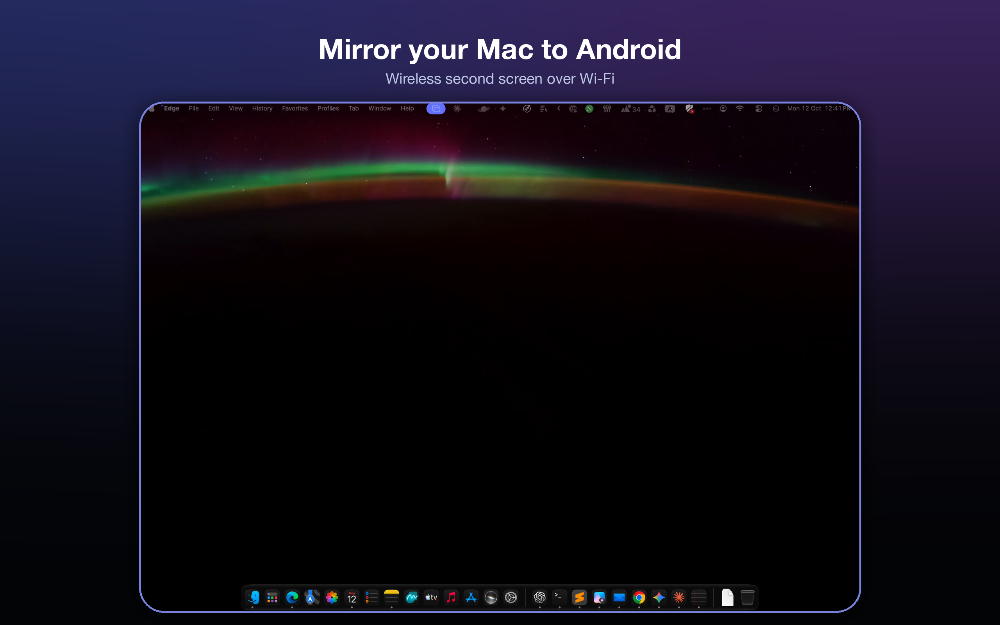
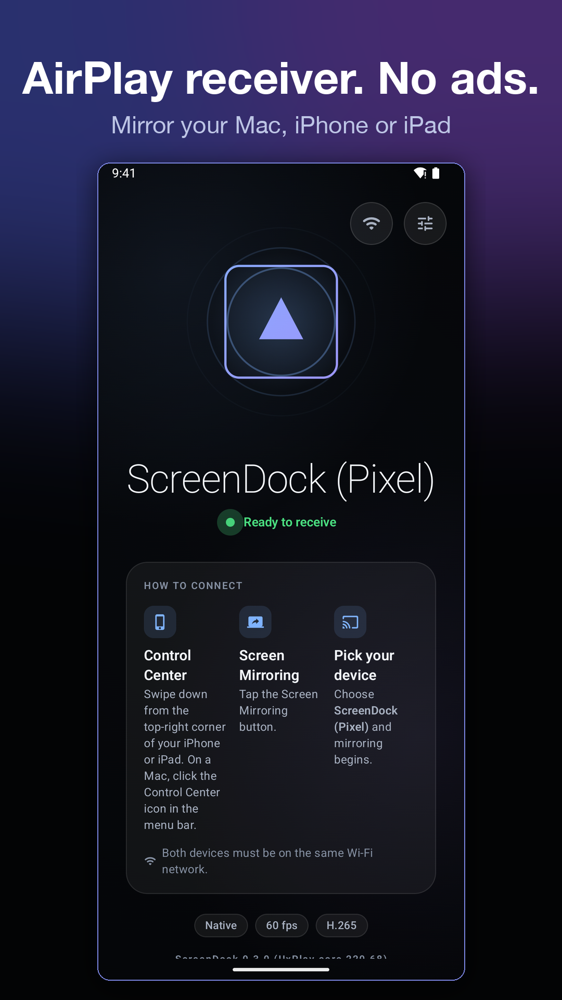
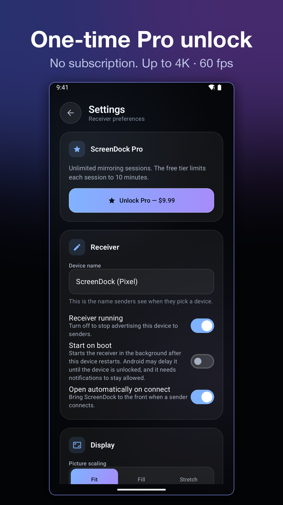
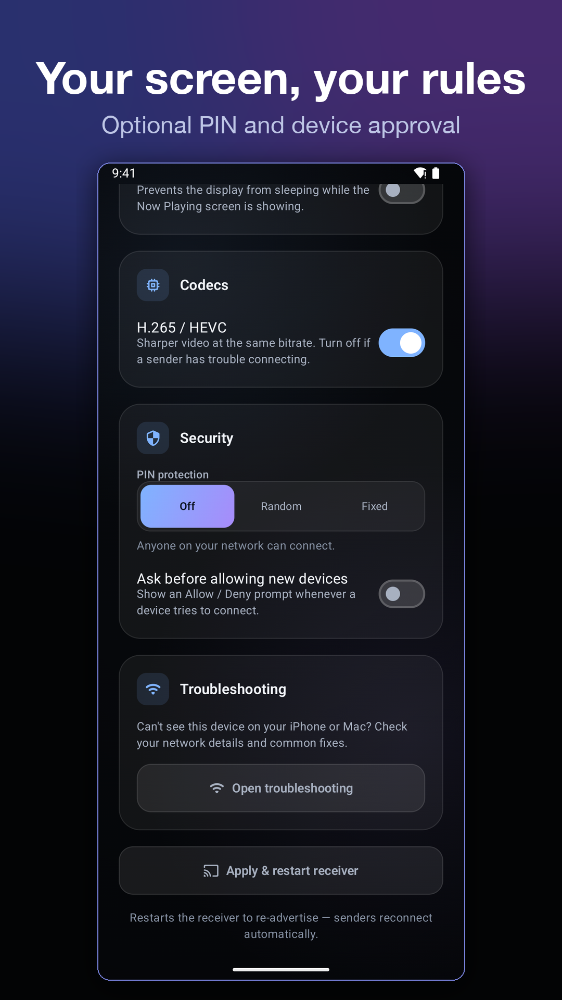

<p align="center">
  
</p>

<h1 align="center">ScreenDock: AirPlay Receiver for Android</h1>

<p align="center">
  Turn your Android phone, tablet or TV into an AirPlay receiver.<br>
  Mirror your Mac, iPhone or iPad over Wi-Fi, with no cables and no ads.
</p>

<p align="center">
  <a href="https://play.google.com/store/apps/details?id=com.cressu.screendock&utm_source=github&utm_campaign=readme">
    
  </a>
</p>

<p align="center">
  
</p>

<p align="center">
  
  
  
</p>

## Features

- **Screen mirroring** from macOS, iOS and iPadOS. H.264 and H.265 (HEVC), up to
  4K at 60 fps, at your display's native resolution.
- **Second display for your Mac.** Use a spare Android tablet as a wireless monitor.
- **AirPlay audio** with AAC and Apple Lossless (ALAC). The Now Playing screen shows
  the title, artist and cover art.
- **AirPlay video.** Send YouTube and web videos with the AirPlay button; they play on
  Android using Media3.
- **Security:** an optional PIN (random or fixed) and "ask before allowing" for each
  new device.
- **Fit, Fill or Stretch** picture modes.
- **Android TV and Google TV** support, with D-pad navigation.
- **Receiver controls:** stop from the notification, optional start at boot, and a
  Wi-Fi low-latency lock while a session is active.
- **No ads, no tracking.** Open source under GPLv3.

## Free and Pro

The app on Google Play is free. It gives you 10 minutes of mirroring or video, then a
30-minute break. Music streaming is always free. **ScreenDock Pro** is a single
one-time in-app purchase that removes the limit. There's no subscription.

The source code here is the full app (GPLv3). You're free to build it yourself.
Buying Pro on Google Play supports development.

## Requirements

- An Android device running Android 7.0 or later
- The sender and the receiver on the **same Wi-Fi network** (5 GHz recommended)
- A Mac, iPhone or iPad with Screen Mirroring or AirPlay

## Known limitations

- **DRM-protected content** (Netflix, Disney+, Apple TV+ and similar) cannot be
  mirrored. This is a technical limitation of FairPlay DRM, not a bug.
- The app implements AirPlay mirroring, audio and video. AirPlay 2 multi-room and
  HomeKit are out of scope.
- Touch forwarding back to the sender is not supported.

## Tested

| Receiver | Sender |
|---|---|
| OnePlus Pad 3 | Mac (macOS), mirroring + audio |
| Samsung Galaxy S23+ (Android 16) | Mac (macOS), mirroring |

Open-source AirPlay receivers are sensitive to sender OS versions.
[Open an issue](https://github.com/tarek369/screendock/issues) with your device and
sender version if something doesn't work.

## How it works

ScreenDock wraps the [UxPlay](https://github.com/FDH2/UxPlay) C core (RAOP/AirPlay
protocol, FairPlay handshake) through JNI. Kotlin handles the rest:

- **Discovery:** the `_airplay._tcp` and `_raop._tcp` services are advertised with
  Android `NsdManager`. TXT records are built in C.
- **Video:** `MediaCodec`, in async low-latency mode, decodes to an EGL/OES pipeline
  that draws onto a `SurfaceView`.
- **Audio:** `MediaCodec` (AAC-ELD/LC) or a hardened Apple ALAC decoder plays through
  `AudioTrack`, paced to the sender's NTP timeline.
- **AirPlay video (HLS):** UxPlay serves the playlist locally, and Media3 ExoPlayer
  plays it.
- **UI:** Jetpack Compose, with a foreground service that owns the receiver lifecycle.

See [`docs/DESIGN.md`](./docs/DESIGN.md) for the full design.

## Build from source

Requirements:
- Android Studio with NDK 27.0.12077973 and CMake 3.22.1
- JDK 17
- `perl`, `python3`, `make` and `patch` (needed to build OpenSSL)

```sh
git clone https://github.com/tarek369/screendock.git
cd screendock
git submodule update --init --recursive   # libplist + openssl-cmake (UxPlay and ALAC are vendored)
export JAVA_HOME=/path/to/jdk-17
./gradlew :app:assembleDebug
adb install -r app/build/outputs/apk/debug/app-debug.apk
```

The first build compiles OpenSSL for each ABI, which takes 2–3 minutes per ABI.

To run the tests:

```sh
./gradlew :app:testDebugUnitTest          # JVM unit tests
sh app/src/test/native/run_tests.sh       # native tests (ASan/UBSan), macOS/Linux host
```

| | |
|---|---|
| `minSdk` | 24 (Android 7.0) |
| `targetSdk` | 36 |
| ABIs | `arm64-v8a`, `armeabi-v7a` (release); `x86_64` is debug-only, for the emulator |

## Privacy

ScreenDock does not collect personal data. Streams go directly from your Apple device
to your Android device over your local network. Privacy policy:
<https://screendock.cressu.com/privacy>

## License

**GPL-3.0-or-later.** See [LICENSE](./LICENSE) and [NOTICE](./NOTICE). The app
statically links UxPlay (GPLv3), so the whole app is a GPLv3 derivative. Bundled
third-party code: UxPlay (GPLv3), playfair, llhttp (MIT), libplist (LGPL-2.1),
OpenSSL (Apache-2.0), Apple ALAC (Apache-2.0).

ScreenDock is an independent project. It is not affiliated with or endorsed by Apple
Inc. AirPlay, Mac, iPhone and iPad are trademarks of Apple Inc. Google Play and the
Google Play logo are trademarks of Google LLC.
